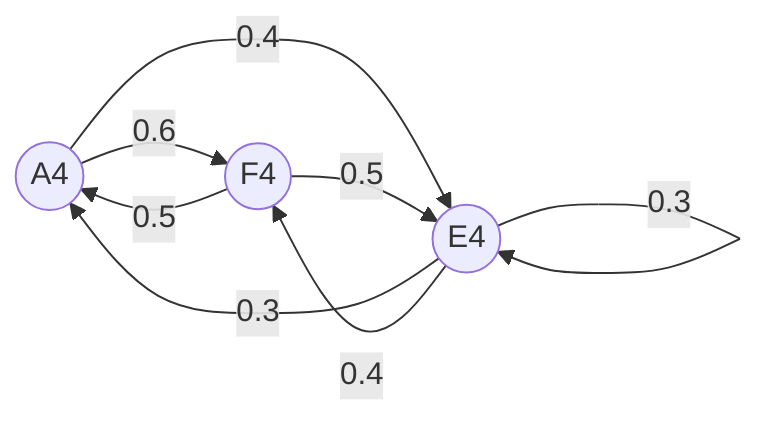
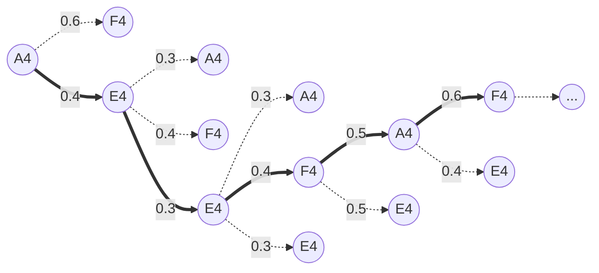

# 基于Markov链的即时音乐生成
| 目录 |
| ---- |
| [前言](#前言) |
| [使用Midi播放音效](#使用Midi播放音效) |
| [Markov链在音乐生成中的应用](#Markov链在音乐生成中的应用) |
| [Markov链简化训练](#Markov链简化训练) |
| [项目搭建指南](#项目搭建指南) |
| [参考文献](#参考文献) |

<a id="前言"></a>

## 前言
随机音乐生成可以考虑三个不同手段: 使用纯随机的生成最简单, 不过作品不一定可以称为'音乐'; 基于生成式AI的生成所能够达到的上限是最高的, 不过其训练数据需要拥有足够数量才能保证其生成优秀作品. 因此, 选择采用基于Markov链的音乐生成可能是最合适的: 它对于资源消耗足够低以至于能够作为生成式音乐的简单研究使用, 同时其生成结果也能够称为音乐.  
本文将解释使用Markov链生成音乐的具体方法并提供具体程序实现. 包括根据Markov链模型进行即时音乐生成, 以及根据Midi文件使用统计方法获取Markov链.  

<a id="使用Midi播放音效"></a>

## 使用Midi播放音效
首先我们需要解决通过音符的音高, 响度等播放音效的方法. 由于Python现有的midi音乐库(例如`mido`库)仅能够播放Midi格式文件, 为了不生成临时文件, 实现真正即时播放, 我选择借助C++的`windows.h`库直接通过`midiOutShortMsg`发声. 此函数可以指定使用的midi乐器, 以及音高和响度. 由于发声需要指定使用的通道, 如果向相同通道发送新的发声指令, 那么电脑就会停止上一个音符的播放. 通过此方法可以主动确定每个音符的持续时长, 从而确定音符的三要素: 音高, 响度和时长.  

我使用`Note`类实现声音输出功能, 其核心方法是`play_note`, 允许指定乐器, 音高, 响度及使用的通道id发声. 不过实现时长控制需要另外处理, 例如主函数可以通过主动`sleep`实现.  
[跳过代码](#code_end1)
```c++
// muse.h
// other includes
#include <windows.h>

#pragma comment(lib, "winmm.lib")   //编译时链接winmm.lib
#pragma once

class Note
    //以单音符形式播放指定声音
{
public:
    void open(void);
    void close(void);
    bool play_note(unsigned short note, unsigned short velocity, unsigned short instrument, unsigned short channel);
private:
    HMIDIOUT handle;
    bool test_input(unsigned short note, unsigned short velocity, unsigned short instrument, unsigned short channel);
};
```
```c++
void Note::open(void)
{
    midiOutOpen(&handle, 0, 0, 0, CALLBACK_NULL);
}

void Note::close(void)
{
    midiOutClose(handle);
}
```
```c++
bool Note::test_input(unsigned short note, unsigned short velocity, unsigned short instrument, unsigned short channel)
//判断输入是否合法
{
    if (note > 127) {
        return false;
    }
    if (velocity > 127) {
        return false;
    }
    if (instrument > 127) {
        return false;
    }
    if (channel > 15) {
        return false;
    }
    return true;
}
```
```c++
bool Note::play_note(unsigned short note, unsigned short velocity, unsigned short instrument = 0, unsigned short channel = 0)
//播放指定的声音,返回值为false时表示播放失败,没有其他错误原因返回
{
    if (Note::test_input(note, velocity, instrument, channel) == false) {
        return false;
    }

    //设置指定的乐器
    if (midiOutShortMsg(handle, 0xC0 + (instrument * 0x100)) != MMSYSERR_NOERROR) {
        return false;
    }
    //播放指定的声音
    if (midiOutShortMsg(handle, 0x90 + channel + (note * 0x100) + (velocity * 0x10000)) != MMSYSERR_NOERROR) {
        return false;
    }

    return true;
}
```
<a id="code_end1"></a>

<a id="Markov链在音乐生成中的应用"></a>

## Markov链在音乐生成中的应用
如果我们把音符作为Markov链的状态节点, 就可以通过Markov链模拟状态的转移进而生成与训练音乐在转移概率方面具有统计一致性的序列. 换句话说, 通过此方法生成的序列和原始训练序列对于Markov链具有相同的转移概率.  
为了直观呈现其在生成方面是如何工作的, 我们不妨考虑仅由三个音符组成的一个Markov链模型:  

我们现在假定每个音符具有相同的时值, 比如说都是四分音符. 该链的转移矩阵如下表所示.  
| State | A4 | F4 | E4 |
| ---- | ---- | ---- | ---- |
| A4 | 0 | 0.6 | 0.4 |
| F4 | 0.5 | 0 | 0.5 |
| E4 | 0.3 | 0.4 | 0.3 |

有了转移矩阵, 我们就可以开始模拟音符序列. 当然现在涉及一个起始序列问题, 我们可以随意选择一个状态开始, 不妨将A4音符作为一个开始. 确定开始后, 就可以根据转移矩阵的概率抛掷硬币. 以下是一个可能的生成序列:  

在实际训练过程中, 我们可以获取单个音符出现的概率. 通过每个音符出现的概率, 我们就可以不用预设音符, 而是通过上述概率确定使用哪个音符作为起始(虽然两种方法在统计意义上并无差异).  

<a id="Markov链简化训练"></a>

## Markov链简化训练
为了简化训练过程, 我简单地采用频率替代Markov转移矩阵要求的概率. 不过, 这一简化要求更高的数据量, 才能基于大数定律进行此简化. 为了尽可能使用相对少的数据满足此要求, 我没有按照音符进行划分, 而是对响度, 音高和时长进行分别训练, 在使用时再进行随机组合. 这一选择的优势在于等效增加响度和音高的数据量(单一参数的允许范围是0~127), 其劣势在于训练结果和原始数据在音符的维度无法保证统计一致.  
基于此简化训练得到的模型, 需要在生成音乐时同时根据三条Markov链获得结果, 随后再行组合.  

### 解析mid文件
使用`mido`库解析mid文件. 经过处理后的部分mid文件内容如下:
```
Track 1: 
program_change channel=0 program=74 time=0
note_on channel=0 note=89 velocity=100 time=0
note_off channel=0 note=89 velocity=100 time=480
note_on channel=0 note=88 velocity=100 time=0
note_off channel=0 note=88 velocity=100 time=240
note_on channel=0 note=86 velocity=100 time=0
note_off channel=0 note=86 velocity=100 time=240
note_on channel=0 note=85 velocity=100 time=0
note_off channel=0 note=85 velocity=100 time=480
note_on channel=0 note=81 velocity=100 time=0
note_off channel=0 note=81 velocity=100 time=480
```
可以发现通过`note_on`和`note_off`表征的音符数据, 因此使用正则表达式解析即可. 以下是解析核心代码: 
[跳过代码](#code_end4)
```python
# train.py
import mido

def read_midi(file_name):
    """读取note, velocity, time(ms)"""
    mid = mido.MidiFile(file_name)

    all_tracks = {}
    # 这里tracks代表了音轨的东西,每条音轨通常情况下就是一个乐器.
    for index, track in enumerate(mid.tracks):
        temp = []
        for msg in track:
            temp_msg = str(msg).split()
            if temp_msg[0] == 'note_on':
                if int(temp_msg[4].split('=')[1]) != 0:
                    # 如果note_on的时间不为0,以休止符的形式记录它
                    # 读取音符数据
                    temp_note = [0]
                    for i in range(3, 5):
                        temp_note.append(int(temp_msg[i].split('=')[1]))
                    temp.append(temp_note)
            
            if temp_msg[0] == 'note_off':
                # 读取音符数据
                temp_note = []
                for i in range(2, 5):
                    temp_note.append(int(temp_msg[i].split('=')[1]))
                temp.append(temp_note)
        all_tracks['track_' + str(index)] = temp

    return all_tracks
```

<a id="code_end4"></a>

### 训练Markov模型
以下是训练过程的实现核心. 输入的`types`是指定参与训练的状态, 例如, 如果音高只有50, 75, 80, 那只需要训练这三个音高即可, 但没必要在训练中先扫一遍数据确定究竟有几个音, 故额外提供`types`参数. `data_list`就是训练数据.  
[跳过代码](#code_end2)
```python
# train.py
import numpy as np

def train(types, data_list):
    """训练Markov链"""
    state_num = len(types)
    total = len(data_list)
    # 制作索引的字典
    type_index = {}
    for num in types:
        type_index[num] = types.index(num)

    statistic_1 = np.zeros(state_num)
    statistic_2 = np.zeros((state_num, state_num))

    # 训练
    pre_state = -1
    for i in range(total):
        state = int(data_list[i])

        statistic_1[type_index[state]] += 1
        if pre_state != -1:
            statistic_2[type_index[pre_state]][type_index[state]] += 1
        pre_state = state

    p_mat_1 = statistic_1 / total
    p_mat_2 = np.zeros((state_num, state_num))
    for row in range(state_num):
        p_mat_2[row] = statistic_2[row] / sum(statistic_2[row])

    return p_mat_1, p_mat_2
```

<a id="code_end2"></a>

值得一提的是, 由于在多个`.mid`文件训练中没有加入文件间分隔, 导致程序将文件起始音和上一文件结束音错误连接, 使得转移矩阵出现一些小偏差. 但此偏差可以忽略不计: 在测试集的五个文件间, 此偏差一共出现4次, 在总计644个连续数据间占0.0063. 虽然对于训练得到的模型此偏差无法忽略, 但是我们的目标是音乐生成, 故考虑到微小偏差无法影响生成效果, 未处理此偏差.  

### 基于Markov链生成序列
以下是生成过程的实现核心. `MarkovGenerator`类负责读取文件形式保存的模型, 并保存历史状态以自动生成下一个音符.   
[跳过代码](#code_end3)
```c++
// muse.h
// other includes
#include <random>
#include <stack>
#include <vector>

class MarkovGenerator
    //生成基于Markov模型的随机输出.自动保存上次的状态
{
public:
    MarkovGenerator();
    void set_fixed_note(unsigned short note);
    void set_fixed_velocity(unsigned short velocity);
    void set_fixed_time(unsigned short time);
    void set_module_note(const char* filename);
    void set_module_velocity(const char* filename);
    void set_module_time(const char* filename);
    void set_seed(double seed);
    unsigned short play_note(Note midi_note, unsigned short instrument, unsigned short channel);
    void print_matrix(void);

private:
    bool set_velocity, set_note, set_time;
    unsigned short fixed_velocity, fixed_note, fixed_time;
    std::default_random_engine rnd_engine;
    std::uniform_real_distribution<double> rnd_;
    // 管理的数据
    // stk_是存储上次状态的栈
    // index_表示状态对应的实际值(通常是间断的)
    // vec1_是无上次状态时的概率分布
    // vec2_实际上是矩阵,存的是所有上次状态的条件概率分布
    // 音高
    std::stack<unsigned short> stk_note;
    std::vector<unsigned short> index_note;
    std::vector<double> vec1_note;
    std::vector<std::vector<double>> vec2_note;
    // 音量
    std::stack<unsigned short> stk_velocity;
    std::vector<unsigned short> index_velocity;
    std::vector<double> vec1_velocity;
    std::vector<std::vector<double>> vec2_velocity;
    // 时长
    std::stack<unsigned short> stk_time;
    std::vector<unsigned short> index_time;
    std::vector<double> vec1_time;
    std::vector<std::vector<double>> vec2_time;

    unsigned short rnd_get(std::vector<double> p_vec);
    void get_matrix(const char* filename, std::vector<unsigned short>& index, std::vector<double> &vec1, std::vector<std::vector<double>> &vec2);
    unsigned short get_value(std::stack<unsigned short> stk, std::vector<unsigned short>& index, std::vector<double>& vec1, std::vector<std::vector<double>>& vec2);
};
MarkovGenerator::MarkovGenerator()
{
    //为什么我只能把这个放到构造函数里
    std::uniform_real_distribution<double> rnd(0, 1);
    rnd_ = rnd;
    //表示所有的模型都没有设定
    set_velocity = false;
    set_note = false;
    set_time = false;
    //默认数据
    fixed_velocity = 100;
    fixed_note = 75;
    fixed_time = 480;
}
```
```c++
unsigned short MarkovGenerator::play_note(Note midi_note, unsigned short instrument = 0, unsigned short channel = 0)
//直接播放声音.输出对应的持续时间(ms)
{
    unsigned short note, velocity, time;

    if (set_note) {
        note = get_value(stk_note, index_note, vec1_note, vec2_note);
    }
    else
    {
        note = fixed_note;
    }

    if (set_velocity) {
        velocity = get_value(stk_velocity, index_velocity, vec1_velocity, vec2_velocity);
    }
    else
    {
        velocity = fixed_velocity;
    }

    if (set_time) {
        time = get_value(stk_time, index_time, vec1_time, vec2_time);
    }
    else
    {
        time = fixed_time;
    }

    midi_note.play_note(note, velocity, instrument, channel);

    return time;
}
```
由于`MarkovGenerator`同样仅处理音高和响度, 故需要接收`play_note`返回的持续时长并另行处理. 由于python中采用`tkinter`进行ui设计, 故使用`after`方法处理时长的问题.  
```python
# tracks.py
# other imports
import muse

class Track():
    """提供声音控件"""
    def __init__(self, window, name, channel, instruments, instruments_id,
                 log, midi_note, midi_open):
        self.window = window
        # ...
        self.midi_note = midi_note
        self.midi_open = midi_open
        self.generator = muse.MarkovGenerator()
        self.is_playing = False
        # ...
    
    # misc methods

    def play(self):
    """播放音乐"""
    if not self.is_playing:
        # ...
    
    if self.midi_open:
        time = self.generator.play_note(self.midi_note, self.instrument, 
                                        int(self.channel))
        self.after_id = self.window.after(time, self.play)
    else:
        # ...

```

<a id="code_end3"></a>

<a id="项目搭建指南"></a>

## 项目搭建指南
此项目应该包含以下脚本文件:  
| 文件 | 备注 |
| ---- | ---- |
| ./main.py | 含ui界面的主程序入口 |
| ./tracks.py | 含ui界面的音频播放控件 |
| ./train.py | 命令行模型训练程序, 独立使用 |
| ./train_ui.py | 含ui界面的模型训练控件 |
| ./request.py | 用于爬取 freemidi.org 的midi文件的爬虫脚本, 独立使用 |
| ./muse.py<br>./_muse.*.pyd | muse.h 经过 swig 编译后的python脚本 |
| ./cpp_header/muse.h | 包括用于midi控件和生成Markov链的类 |
| ./cpp_header/muse.i | 用于 swig 编译的接口文件 |
| ./cpp_header/setup.py | 用于 swig 编译的接口打包脚本 |


### python项目搭建
我使用的python项目环境(不包含非第三方库):
|  | 版本 | 备注 |
| ---- | ---- | ---- |
| Python | 3.11.5 |
| NumPy | 1.26.4 |
| Mido | 1.3.2 |
| PyAutoGUI | 0.9.54 | 不必要 |

如无特殊版本需求, 直接使用以上版本即可:
```
pip install -r requirements.txt
```
与版本相关性最高的是`_muse.*.pyd`文件. 例如`_muse.cp311-*.pyd`仅支持3.11.x版本Python使用, 因此视情况而言可能需要重新编译`muse.h`文件.  
环境安装完成后测试能否正常运行`main.py`即可.  

### 使用swig编译muse.h
首先须安装`swig`: [Download SWIG](http://www.swig.org/download.html).
`muse.h`的接口文件已经放入项目, 因此直接编译接口即可:  
```
swig -c++ -python muse.i
```
完成后, 应该增加`muse.py`和`muse_wrap.cxx`两个文件. 同样, 打包脚本也在项目中:  
```
python setup.py build_ext --inplace
```
完成后, 将`muse.py`和`_muse.*.pyd`放入主目录即可.  

### 项目测试
此项目包含一个测试集.  
用于测试训练的mid文件来自参考文献[~[1]~](#ref1)提供的[github仓库](https://github.com/ilanashapiro/Markov-Model-Music-Generation)包含的mid文件.  
测试用mid文件: <big>./test/</big>
基于测试用mid文件生成的模型文件可用于生成测试.  
测试用模型文件: <big>./models/</big>
附注: 此项目在测试集上表现良好, 但在来自 freemidi.org 的文件上训练效果并不理想. 这可能是因为mid文件解析程序对于真实环境的文件未能完全解析.  

<a id="参考文献"></a>

## 参考文献

<a id="ref1"></a>

[1]Ilana Shapiro,Mark Huber.Markov Chains for Computer Music Generation[J].Journal of Humanistic Mathematics,2021,11(2):167-195.